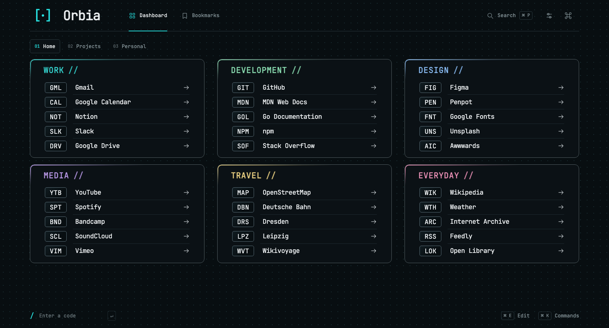

# Orbia

Orbia is a self-hosted keyboard launcher and bookmark library for one person. The dashboard opens quicklinks by three-character code. The library searches saved titles, URLs, descriptions and notes, with exact tag filters. Both use the same Go process and SQLite database. The browser loads HTML, CSS, JavaScript and JetBrains Mono from your server.



## Run on Unraid

1. Copy the project to your server and copy `.env.example` to `.env`.
2. Create `/mnt/user/appdata/orbia` and give the configured UID/GID write access. The example uses Unraid's `99:100`. Use local storage with SQLite locking support.
3. Start the service from the project directory.

```sh
docker compose config --quiet
docker compose up -d --build --wait
docker compose ps
```

Open `http://<unraid-host>:8080`. In **Set up Orbia**, choose a password of at least 12 characters or select **Without a password**, then save. The first visitor to save this choice configures the instance. Complete setup on a trusted network before exposing Orbia publicly. Existing installations upgrading from environment-based passwords also complete this step once.

In **Settings → Access**, enter your current password to change or remove it. You can enable password protection again there. Saving the access settings signs out other browser sessions. In passwordless mode, anyone who can reach Orbia can open a session and manage bookmarks, tokens and access settings. Use it only on a trusted network or behind an authenticated proxy.

New databases start with a **Home** dashboard linking to Amazon, eBay, Gmail, GitHub, Booking.com, Figma, and Notion. Use **Cmd/Ctrl+E** to edit the quicklinks. The bookmark library starts empty. Set `ORBIA_SEED_DEMO=true` to populate an empty library with six English-language example bookmarks, then switch it off to keep an emptied library empty on restart. Upgrades preserve your saved dashboard and bookmarks.

For a local Docker installation, use `ORBIA_DATA_DIR=./data`, set `PUID` and `PGID` to the owner of that directory, and bind to `127.0.0.1`. The container runs as that user with a read-only root filesystem. Compose persists the database under `/data`. The HTTP healthcheck uses `/healthz`.

| Setting | Purpose |
| --- | --- |
| `ORBIA_PORT`, `ORBIA_BIND` | Published host port and interface. Defaults are 8080 and 0.0.0.0. |
| `ORBIA_DATA_DIR`, `PUID`, `PGID` | Host bind mount and numeric process identity. |
| `ORBIA_ORIGIN` | Exact external origin behind a reverse proxy, e.g. `https://orbia.example.com`. Used for origin checks and pagination links. |
| `ORBIA_SECURE_COOKIE` | Set to `true` when serving over HTTPS. |
| `ORBIA_DB`, `ORBIA_ADDR` | Native process database path and listen address. Compose supplies `/data/orbia.db` and `:8080`. |

Serve Orbia at the root of its own domain. Preserve the Host header and pass `/api/` token requests through the proxy. Browser sessions expire after 24 hours or on server restart. Use HTTPS when accessing Orbia across a network so that passwords and API tokens are encrypted in transit.

## Interface language

Orbia opens in English by default. Choose **Settings → Language → Deutsch** to switch to German. Orbia remembers your choice in this browser and applies it to the sign-in screen, dashboard, library, editors and commands. Saved names, tags, notes and quicklink codes keep their original spelling.

The English catalog loads from the Orbia server on demand and the browser can cache it. Switching languages updates the current view in place. Search uses the same API, SQLite indexes and debounce settings in both languages.

## Keyboard and touch

| Action | How |
| --- | --- |
| Launch an app | Type a code prefix on the dashboard. Other links dim. As soon as one code matches, the preview shows the name and destination. Enter opens it, Backspace corrects the prefix and Escape clears it. |
| Change dashboard | Press 1–9 or choose a page in the command palette. Each page has its own groups and codes. The touch input also accepts codes that begin with a digit. |
| Edit the dashboard | Cmd/Ctrl+E opens edit mode. Select a link to change its name, code, group or URL. Edit group names, colors and order using their controls. Each page supports up to six groups. |
| Add a quicklink or bookmark | Press **+** outside a text field to add a quicklink on the dashboard or a bookmark in the library. The header and mobile bar also offer an add button. |
| Create or switch lists | Cmd/Ctrl+K opens the command palette. Choose a dashboard page, create one or change the theme. Arrow keys select a command and Enter runs it. |
| Browse bookmarks | Choose **Tags** on desktop or **Bookmarks** on mobile. Switch between cards and rows, edit notes and tags, and open the archive. |
| Search from either mode | Cmd/Ctrl+P or **Suche** opens a panel in the lower third on desktop. Type `#games #arpg #diablo Loot`. Every tag and text term must match. While typing a final hashtag such as `#d`, the panel and library suggest matching tag names and show bookmarks with any of those tags. Click a suggestion or type a space after the full tag to apply it as an exact filter. Earlier tags and text constrain both results and suggestions. Use the arrows and Enter, or tap a result. |

The desktop header also accepts the displayed punctuation shortcuts outside text fields. The app reserves unmodified letters for quicklink codes. Theme, dashboard page and bookmark layout persist per browser. Dates are present in API records for interchange. The interface shows no clock or date.

## Linkding clients and data transfer

Open **Settings → Linkding integrations**, enter an app name and select **Generate token**. Copy the token before closing Settings. Enter the displayed Orbia server address and the token in Raycast or the Chrome/Firefox Linkding extension. Each token can read and modify the bookmark library through the Linkding-compatible API. Select **Revoke** beside an app to stop its access immediately.

Token hashes are stored in SQLite and excluded from HTML and JSON exports.

Orbia implements the bookmark, tag and profile operations those clients use, including both trailing-slash forms and their browser search/edit links. Contract tests exercise the request sequences. The compatibility notes record the exact client source revisions and unsupported features. [Client contracts](docs/compatibility.md) · [API coverage](docs/linkding-compatibility.md) · [Upstream API](https://linkding.link/api/)

**Settings → Import & Export** accepts Netscape bookmark HTML from Linkding and browsers. HTML preserves tags, descriptions, Linkding notes, archive/unread/shared flags and second-resolution timestamps. JSON backups also include dashboard pages and unused tags. File imports merge by URL in one transaction. Restoring a dashboard from JSON replaces the current pages. Database IDs are local. The import limit is 20 MiB.

### Import bookmarks from a running Linkding server

In **Settings → Import from Linkding**, enter the address of your Linkding installation and an API token issued by that installation. Choose **Start import** and keep the tab open for the result. Orbia reads active and archived bookmarks in batches. Matching URLs take their titles, notes, tags and flags from Linkding. The source token is used for this request only. For HTTPS, Orbia must trust the source certificate. On a trusted LAN, an Unraid installation can use an address such as `http://192.168.1.20:9090` (use your host IP and published Linkding port) or a Docker service name on a shared network. For HTTP, the import accepts only private IPv4, IPv6 unique-local, or loopback addresses. Every resolved address must qualify. Orbia connects directly to a checked IP and skips HTTP proxies. Both schemes reject redirects. HTTP exposes the source token to anyone able to observe the local connection. When opening Orbia from the internet, access Orbia itself over HTTPS as well. Only one UI import runs at a time, with a ten-minute deadline. If interrupted, completed batches are retained and you can start the import again.

You can repeat an import to pick up new or edited bookmarks. Orbia skips unchanged records and keeps local bookmarks when a URL is deleted or renamed on the source. The Orbia container must be able to reach the Linkding server.

For a full backup with stable IDs, stop the container, copy its **entire** data directory, then restart it. Restore that directory with the container stopped and the correct owner. Keep a separate copy of your configuration.

## Develop and test

A native build requires Go 1.26+, a C compiler, SQLite headers and a library with FTS5. On Debian/Ubuntu install `build-essential libsqlite3-dev`. Run `go run ./cmd/orbia` and complete setup in the browser. The native process reads its environment. Compose reads `.env`.

```sh
go test -race ./...
go vet ./...
npm ci
npm run check
npx playwright install chromium webkit
npm run test:e2e
ORBIA_BROWSER=webkit npm run test:e2e
```

Node and Playwright are development dependencies. The browser suite starts the real HTTP handler on a temporary loopback port with its own SQLite database. `ORBIA_SCREENSHOTS` selects an optional output directory. `PLAYWRIGHT_EXECUTABLE` can select an installed browser binary.

See the [architecture and design decisions](docs/architecture.md), [feature status](docs/status.md) and [validation report](docs/validation.md) for test evidence and deployment limits.
